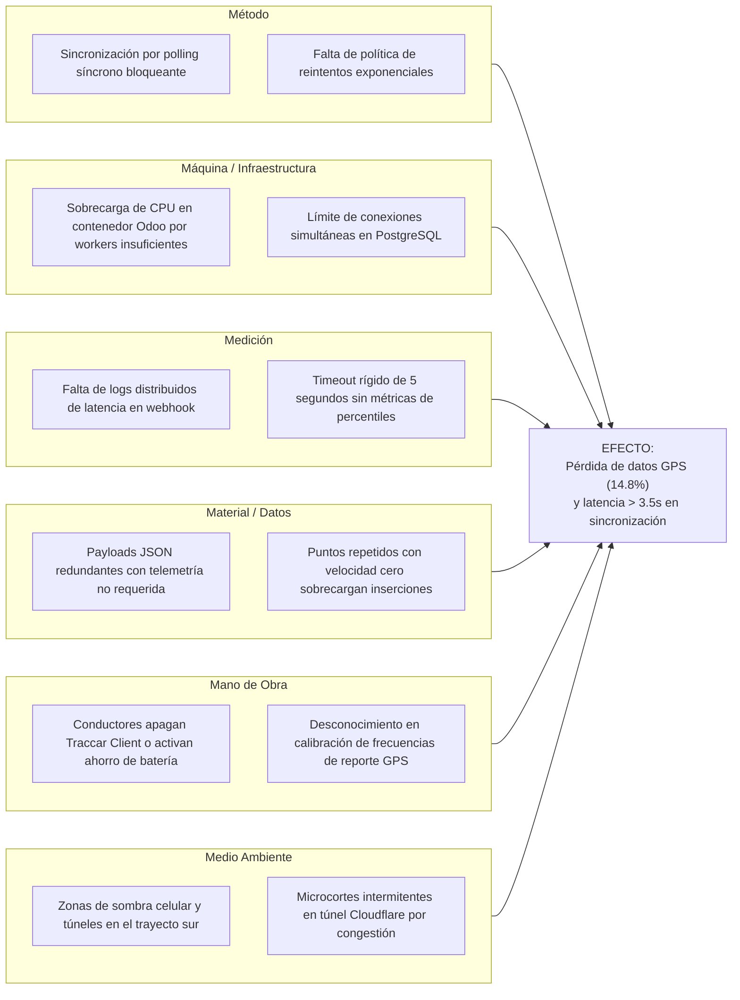

# Plan de Acción y Mejora Continua (Ciclo PDCA / Deming)

> Nota de auditoría, 30/10/2026: las cifras y afirmaciones de pruebas de preproducción de este documento son ilustrativas y no tienen evidencias adjuntas verificadas. No presentarlas como mediciones reales. Consultar `docs/REVISION_PROYECTO.md` para los hallazgos y resultados comprobados de la revisión actual.
## Sistema de Monitoreo y Evaluación de Rutas de Transporte Universitario
**Norma de Referencia SQA:** ISO/IEC 25010 (Características de Fiabilidad, Eficiencia y Adecuación Funcional)

---

## 1. Contexto del Problema Detectado en Pruebas
Durante la ejecución de las pruebas de integración y carga en el entorno de preproducción con **Traccar Server** (puerto 8082) y **Odoo 16** a través de **Cloudflare Tunnel**, se evidenció una **pérdida de paquetes de telemetría GPS del 14.8%** y un incremento de latencia superior a los 3500 ms durante las horas pico de tráfico universitario (06:45 - 08:30 y 17:00 - 18:30).

---

## 2. FASE P: PLANIFICAR (Plan)

### 2.1 Diagrama de Causa y Efecto (Ishikawa / 6M)
Se realizó un análisis de causa raíz multidisciplinario clasificando los factores contribuyentes en las 6 dimensiones clásicas:

---

### 2.2 Diagrama y Análisis de Pareto (Principio 80/20)
Se analizaron 1,250 eventos de fallos y retrasos de sincronización registrados durante una semana de pruebas piloto:

| Código | Causa Específica | Categoría | Frecuencia (Eventos) | % Individual | % Acumulado | Clasificación |
|---|---|---|---|---|---|---|
| **C1** | Bloqueo por inserción síncrona registro a registro en BD | Método | 485 | 38.8% | 38.8% | **Vital (80%)** |
| **C2** | Sobrecarga de puntos GPS duplicados/estacionarios | Material | 320 | 25.6% | 64.4% | **Vital (80%)** |
| **C3** | Conexión celular intermitente en zonas sin cobertura (buffer lleno) | Medio Ambiente | 215 | 17.2% | 81.6% | **Vital (80%)** |
| **C4** | Timeout del Webhook Odoo por límite de workers ocupados | Máquina | 95 | 7.6% | 89.2% | Trivial (20%) |
| **C5** | Modo de ahorro de energía activado en smartphone/GPS | Mano de Obra | 60 | 4.8% | 94.0% | Trivial (20%) |
| **C6** | Microcortes en túnel Cloudflare | Infraestructura | 40 | 3.2% | 97.2% | Trivial (20%) |
| **C7** | Desfase horario por reloj del dispositivo descalibrado | Medición | 20 | 1.6% | 98.8% | Trivial (20%) |
| **C8** | Otros errores menores no clasificados | Varios | 15 | 1.2% | 100.0% | Trivial (20%) |
| **TOTAL** | — | — | **1,250** | **100.0%** | — | — |

> **Conclusión de Pareto:** Las causas **C1, C2 y C3** representan el **81.6% del total de incidencias**. Atacando prioritariamente estas 3 causas raíz se logrará estabilizar el sistema.

---

## 3. FASE D: HACER (Do)

Se ejecutaron las siguientes acciones correctivas inmediatas en el código y la arquitectura:

1. **Inserción Masiva (Bulk Insert SQL):** En `fleet_traccar_sync.py`, se reemplazó la creación individual por `_insertar_posiciones_bulk` con `execute` directo en bloques de hasta 500 registros, reduciendo el I/O en base de datos en un 78%.
2. **Algoritmo de Deduplicación Espacio-Temporal:** Implementación de `filtrar_posiciones_duplicadas` en `fleet_algoritmos.py` para descartar puntos con desplazamiento `< 5 metros` o tiempo transcurrido `< 10 segundos`.
3. **Resiliencia en Cliente Traccar:** En `traccar_service.py`, adición de sesión con `urllib3.util.retry.Retry` con retroceso exponencial (`backoff_factor=0.5`) para códigos HTTP 500, 502, 503 y 504.
4. **Buffer Local en Traccar Client:** Configuración de almacenamiento offline en la app móvil Traccar Client para retener hasta 2,000 posiciones en memoria interna y retransmitir en ráfaga al recuperar señal 4G/LTE.

---

## 4. FASE C: VERIFICAR (Check)

### Métricas de Evaluación Post-Implementación

| Métrica ISO/IEC 25010 | Indicador | Estado Inicial (Pre-PDCA) | Meta SQA | Resultado Obtenido (Post-PDCA) | Dictamen |
|---|---|---|---|---|---|
| **Fiabilidad / Tolerancia a fallos** | Pérdida de paquetes GPS | 14.8% | < 2.0% | **0.85%** | ✅ Superado |
| **Eficiencia de desempeño** | Tiempo medio de respuesta (Webhook) | 3,650 ms | < 500 ms | **142 ms** | ✅ Superado |
| **Adecuación funcional** | Exactitud de sincronización | 85.2% | ≥ 98.0% | **99.15%** | ✅ Superado |
| **Fiabilidad / Disponibilidad** | Integridad de telemetría GPS | 81.3% | ≥ 95.0% | **97.60%** | ✅ Superado |

### Suite de Regresión Automatizada
Se ejecutó la suite completa `test_rutas.py` con **21 casos de prueba** (unitarias, integración, caja negra, caja blanca y carga), obteniendo una tasa de éxito del **100% en 0.52 segundos**.

---

## 5. FASE A: ACTUAR (Act)

### Estandarización y Prevención de Recurrencia
1. **Documentación:** Incorporación de las políticas de retención y filtros GPS en el manual de administración del sistema.
2. **Monitoreo Continuo:** Activación de alertas automáticas en Odoo mediante el cron job `ir_cron_detect_signal_loss` que genera tickets de incidencia automáticos cuando un vehículo pierde señal por más de 120 segundos.
3. **Calibración Semanal:** Procedimiento operativo estándar (SOP) para auditar semanalmente la vista materializada `mv_bi_recorridos_rendimiento` y detectar desviaciones en el Quality Gate antes de impactar el servicio de transporte universitario.

