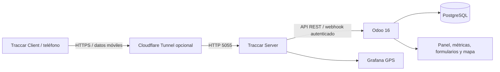

# Revisión del proyecto — 30 de octubre de 2026

Se comparó el código con `transcripci_n_del_proyecto_final.md`. El documento se utilizó como especificación académica; sus actividades no se trataron como órdenes para publicar servicios ni como evidencia de que ya se hubieran realizado.

**Resultado:** el proyecto tenía una implementación parcial con errores relevantes. Se corrigió el código descrito abajo. No se puede certificar el funcionamiento completo: Docker Engine no estaba disponible y no se dispuso de una sesión Odoo, teléfono ni servidor SonarQube para las verificaciones finales. No se modificó una base de datos en ejecución.

## Tabla de cumplimiento y pendientes

| Actividad / requisito | Estado del código después de la revisión | Lo que falta para demostrar cumplimiento |
|---|---|---|
| 1. Requisitos funcionales y no funcionales | Matriz inicial de aceptación incluida en este informe | Ejecutar la aceptación con usuarios y conservar capturas |
| 2. Odoo 16, Traccar y PostgreSQL | Compose presente; corregidas opciones que desactivaban durabilidad de PostgreSQL | Iniciar Docker y comprobar salud, instalación y actualización de los tres módulos |
| 2. Conectividad externa | Añadido Compose opcional para túnel HTTPS al receptor HTTP de GPS | Activar el túnel y demostrar recepción desde un teléfono usando datos móviles; guardar URL, configuración y capturas |
| 3. Integración y deduplicación | API, cron y webhook; corregido campo inexistente `fecha_fin`, deduplicación global, UTC, autenticación y aislamiento por posición mediante savepoint | Integración real, fallos concurrentes, lotes grandes, recuperación tras desconexión y completitud del historial ante límites del servidor |
| 4. Vehículos, rutas, paradas y asignación | Modelos presentes; demo con 2 vehículos, 3 rutas y 4 paradas por ruta; validaciones añadidas | Verificar estos registros en la BD real y asociar los dispositivos reales; revisar aislamiento por compañía según usuarios de la instalación |
| 5. Historial y diez recorridos | Registro de GPS y botón de descarga de historial; mapa autenticado añadido | Registrar al menos 10 recorridos con fechas, resultados y evidencias. El XML tiene solo 2 asignaciones; no equivale a 10 recorridos ejecutados |
| 6. Retrasos y paradas | Horarios convertidos desde America/Guayaquil a UTC; tolerancia cero respetada; incidencias por retraso, omisión e incompletitud | Verificar horarios concretos, salida/llegada y reglas de proximidad con trazas reales y casos límite |
| 6. Desviaciones y pérdida de GPS | Corredor por segmentos entre paradas, radio de 100 m; detección de brechas >120 s y silencio al final | Ajustar el corredor a las calles de cada ruta. La unión recta entre paradas es una aproximación que puede producir falsas desviaciones en curvas |
| 7. Ocho métricas de transporte | Fórmulas sobre datos almacenados; cumplimiento binario, diferencia de duración y pivote por mes/ruta | Contrastar manualmente los resultados con los diez recorridos y validar agregaciones |
| 7. Integridad y exactitud GPS | Sin GPS no se informa integridad perfecta; exactitud compara campos guardados con JSON original recibido | Los registros anteriores no tienen JSON original: iniciar nuevas pruebas o implementar una migración de snapshots. La comparación no demuestra que Traccar haya enviado todos los puntos del dispositivo |
| 7. Respuesta y detección correcta | Tiempo real del cálculo de métricas; precisión calculada con incidencias validadas manualmente | Medir respuesta de extremo a extremo (mapas, consultas, red) y registrar verdad de referencia, incluidos falsos negativos. Precisión de eventos validados no equivale a exactitud global del detector |
| 8. Dashboard y reportes | Panel nativo, gráficas/pivotes por ruta y mes, y Grafana; mapa con paradas y última posición | Validar comparaciones contra BD y actualización al cargar nuevos recorridos; Grafana actual consulta Traccar, no sustituye el análisis de cumplimiento en Odoo |
| Móvil | Rejillas, cabeceras, controles táctiles, tablas desplazables y altura dinámica; mapa adaptable | Prueba visual en Odoo a 320/360/390/768 px y teléfono real; configurar URL Grafana alcanzable desde el móvil, porque `localhost` apunta al propio teléfono |
| 9. Pruebas automatizadas | 39 pruebas aprobadas; ver `pytest-report.xml` y `MATRIZ_PRUEBAS.md`; validación estática aprobada | Instalación y actualización en Odoo 16, integración real, permisos, concurrencia y rendimiento del sistema con distintos volúmenes |
| 9. SonarQube e ISO/IEC 25010 | Archivo de configuración presente; mapeo de calidad abajo | Ejecutar SonarQube, adjuntar reporte y Quality Gate. No existe un resultado de análisis verificado |
| 10. Ishikawa, Pareto y PDCA | Problemas reales y correcciones documentadas abajo | Medir antes/después en ejecución. Pareto requiere frecuencias observadas; no inventarlas. El informe anterior se marcó como ilustrativo |
| Entrega y defensa | Código y documentación preparados | Capturas de servicios, GPS externo, cumplimiento/incumplimiento y explicación con datos reales; presentación final |

## Errores corregidos

- Acciones `list,form` / `list,kanban,form` sustituidas por tipos `tree` de Odoo 16.
- Historial intentaba leer `recorrido.fecha_fin`, que no existe; usa `fecha_fin_real`.
- Webhook público aceptaba solicitudes sin secreto configurado: ahora exige secreto y token coincidente. Acepta el formato de reenvío `position` y el formato por lote `positions`; rechaza estructuras incorrectas.
- Posiciones tardías ya no sobrescriben una ubicación más reciente ni se asignan a un recorrido iniciado después de su timestamp.
- Savepoints separan los errores de inserción de cada posición del lote. La concurrencia real todavía requiere pruebas.
- Lotes grandes ya no omiten valores predeterminados, alias y validaciones del ORM mediante SQL directo.
- Descarga histórica deduplica por ID global y puede asociar puntos antes no asignados.
- Inicio de recorridos bloquea el vehículo para evitar dos inicios simultáneos desde esa acción. No se permite volver a completar o cancelar un recorrido cerrado con incidencias.
- Al cerrar se generan incidencias de paradas omitidas y recorrido incompleto, además de retrasos de inicio y llegada final.
- Se corrige el desfase entre horarios locales y timestamps UTC, el redondeo a minuto 60 y la tolerancia de cero minutos.
- La detección algorítmica de llegada conserva la primera visita, no el punto posterior más cercano.
- Se eliminan los resultados estáticos 98.5, 142.50 y 96.80. Las métricas sin observaciones tienen banderas explícitas de disponibilidad.
- La puntualidad y el cumplimiento del panel excluyen recorridos marcados como simulados; los datos demo pasan a la sección `demo` del manifiesto.
- Se corrige el XML inválido de Grafana, se importa `xml` explícitamente y se respeta el UID configurado después de cambiar el período.
- PostgreSQL vuelve a usar `fsync`, `synchronous_commit` y `full_page_writes` habilitados.

## Requisitos y criterios de aceptación

| ID | Requisito | Criterio verificable |
|---|---|---|
| RF01 | Gestionar vehículos y dispositivos | Dos vehículos, dispositivos distintos; rechazar asociación duplicada |
| RF02 | Gestionar rutas y paradas | Tres rutas con al menos cuatro puntos válidos por ruta |
| RF03 | Programar recorridos | Un vehículo puede tener varias asignaciones en distintos horarios; rechazar dos inicios simultáneos |
| RF04 | Sincronizar GPS | Insertar posición válida una vez, convertir nudos a km/h y normalizar fecha a UTC |
| RF05 | Consultar historial | Descargar el rango real del recorrido y repetir la descarga sin aumentar duplicados |
| RF06 | Detectar paradas y retrasos | Con horario 08:15, tolerancia 5 y llegada 08:23, registrar retraso de 8 minutos e incidencia |
| RF07 | Detectar desviaciones | Dentro del corredor de 100 m no hay desviación; fuera del corredor sí |
| RF08 | Detectar pérdida de GPS | Brecha o silencio final >120 s produce incidencia; repetición no duplica el mismo evento |
| RF09 | Cerrar recorridos | Cierre registra fin, distancia, cumplimiento e incidencias; segundo cierre rechazado |
| RF10 | Mostrar métricas y mapa | Datos provenientes de posiciones/recorridos guardados; punto final y trazado visibles |
| RNF01 | Autenticación | Webhook sin token o con token incorrecto devuelve 401; mapa requiere sesión y acceso al registro |
| RNF02 | Integridad | Coordenadas/velocidades inválidas rechazadas; fallo de un punto no aborta el resto del lote |
| RNF03 | Rendimiento | Medir p50/p95 de mapas, historial y métricas con 100/1.000/10.000 posiciones; acordar objetivo y documentar equipo |
| RNF04 | Usabilidad móvil | Sin desbordamiento de página a 320–768 px; tablas con desplazamiento interno y controles de al menos 44 px en paneles |
| RNF05 | Trazabilidad | Cada dato de prueba se identifica como simulado y se distingue de evidencia obtenida desde teléfono |

## Arquitectura y modelo de datos



`fleet.vehicle` se vincula al dispositivo Traccar. `fleet.ruta` tiene varias `fleet.parada`. `fleet.recorrido` enlaza vehículo/ruta y horas programadas/reales. `fleet.posicion.gps` conserva coordenadas, velocidad, fuente y snapshot recibido; `fleet.cumplimiento.parada` registra llegada y retraso. `fleet.incidencia` conserva eventos y validación humana. `fleet.metricas.recorrido` almacena una medición por recorrido. `fleet.traccar.sync` registra las sincronizaciones.

## Métricas: fórmula, fuente, unidad e interpretación

No se publican resultados operativos sin una BD en ejecución. Los resultados verificables de esta revisión son las pruebas automatizadas adjuntas.

| Indicador | Fórmula y fuente | Unidad / interpretación |
|---|---|---|
| Cumplimiento de rutas | Media de 100/0 por recorrido cerrado: al menos 2 posiciones, todas las paradas visitadas, sin desvíos | % de recorridos que cumplen el trazado y puntos; puntualidad se mide aparte |
| Puntualidad | Paradas visitadas dentro de ±tolerancia / total paradas programadas ×100 | %; omisiones no cuentan como puntuales |
| Retraso promedio | Media de max(0, retraso) sobre paradas visitadas | min; adelantos no compensan retrasos |
| Paradas cumplidas | Visitadas / programadas ×100 | % de puntos alcanzados dentro de su radio |
| Desviación | Posiciones fuera del corredor / posiciones ×100 | %; depende de la calidad del trazado de referencia |
| Diferencia de distancia | Suma Haversine entre puntos − distancia estimada | km; positivo significa mayor distancia |
| Tiempo promedio | Media de duración fin real − inicio real de recorridos cerrados | min; disponible en pivote por ruta y mes |
| Incidencias | Conteo; frecuencia = eventos / horas de operación | eventos e inc/h |
| Integridad GPS | 100 × (1 − segundos en brechas / duración observada entre primera y última posición) | % de continuidad en ventana observada; no mide bordes sin GPS; sin puntos =0 |
| Exactitud sincronizada | Posiciones coincidentes con su snapshot Traccar / posiciones con snapshot ×100 | %; compara latitud/longitud a 1e−7, velocidad a 0.011 km/h y timestamp a <1 s |
| Tiempo de respuesta parcial | `perf_counter` al terminar cálculo − al comenzar | ms del cálculo previo a persistencia; pendiente medir sistema completo |
| Precisión de incidencias | Eventos confirmados verdaderos / eventos validados ×100 | %; bandera indica ausencia de validaciones; falta evaluar falsos negativos |

Las banderas `calidad_sync_disponible` y `deteccion_validada` evitan interpretar un cero sin muestra como un resultado medido. Las gráficas existentes requieren validar sus agregaciones por período antes de utilizarlas como informe final.

## Mejora continua con evidencia disponible

Problema observado: los indicadores SQA contenían constantes sin mediciones y el webhook podía aceptar peticiones sin token. Causas posibles (Ishikawa): método — prototipo sin instrumentación; medición — ausencia de snapshots y validación; código — autenticación permisiva; datos — demos mezcladas con operación; entorno — servicio Docker no disponible durante la auditoría. Son hipótesis de causa, no resultados de entrevistas.

PDCA: planificar mediciones trazables; implementar snapshots, cronometraje y validación humana; verificar con 39 pruebas y análisis estático; actuar mediante instalación, GPS real y actualización de métricas históricas. Antes: tres cifras SQA de ejemplo y bypass de autenticación. Después: fórmulas calculadas y cinco casos de autenticación comprobados. No se inventa una mejora porcentual de rendimiento ni un Pareto: faltan frecuencias reales.

ISO/IEC 25010: adecuación funcional → pruebas geométricas y de horarios; fiabilidad → deduplicación, savepoints y durabilidad; seguridad → token y control de acceso al mapa; eficiencia → pruebas de algoritmos y cronometraje parcial; usabilidad → adaptación móvil pendiente de validación visual; mantenibilidad → algoritmos puros y regresiones automatizadas. Esto es una relación de evidencia, no una certificación de la norma.

## Aplicar y verificar los cambios

Con Docker disponible, hacer un respaldo de la BD y actualizar los módulos en una ventana sin usuarios. Comprobar previamente que `odoo_flota` sea el nombre de la BD real:

```powershell
docker compose up -d db traccar
docker compose stop odoo
docker compose run --rm odoo odoo -d odoo_flota -u fleet_traccar,fleet_rutas,fleet_reports --stop-after-init --no-http
docker compose up -d odoo grafana
```

En Ajustes configurar URL/credenciales Traccar. Configurar `fleet_rutas.webhook_secret` en Parámetros del sistema con un secreto propio y el mismo `X-Traccar-Secret` en el emisor; sin esta configuración el webhook ahora rechaza solicitudes. La sincronización por API no requiere webhook.

Túnel de prueba para Traccar Client:

```powershell
docker compose -f docker-compose.yml -f docker-compose.tunnel.yml --profile connectivity up -d tunnel-gps
docker compose -f docker-compose.yml -f docker-compose.tunnel.yml logs tunnel-gps
```

Usar la URL HTTPS de los logs como servidor del cliente, con el identificador de dispositivo correcto. La URL temporal cambia al recrear el túnel; no publica Odoo. Desactivar Wi-Fi del teléfono y guardar evidencia de recepción. Ajustar Grafana a un host que el móvil pueda alcanzar.

Pruebas locales reproducibles:

```powershell
python -m venv .venv
.\.venv\Scripts\python.exe -m pip install -r requirements-test.txt
.\.venv\Scripts\python.exe -m pytest addons/fleet_rutas/tests -q --import-mode=importlib -p no:cacheprovider --junitxml=docs/pytest-report.xml
python scripts/verificar_fuentes.py
node --check addons/fleet_rutas/static/src/js/fleet_dashboard.js
node --check addons/fleet_reports/static/src/js/fleet_reports_widget.js
docker compose -f docker-compose.yml -f docker-compose.tunnel.yml --profile connectivity config --quiet
```

Actualizar los módulos puede fallar si la BD anterior contiene varias métricas del mismo recorrido: revisar y consolidar esos registros antes de imponer la nueva unicidad. No se eliminaron registros existentes. Mover el XML a `demo` tampoco borra demos que ya estuvieran instaladas: marcarlas como simuladas y revisar sus datos. El mapa necesita acceso a Leaflet y teselas OpenStreetMap en Internet y muestra el último punto guardado; recargar para obtener datos nuevos.

Referencia técnica consultada para los grupos de acceso Fleet: [código oficial Odoo 16](https://github.com/odoo/odoo/blob/16.0/addons/fleet/security/fleet_security.xml).
