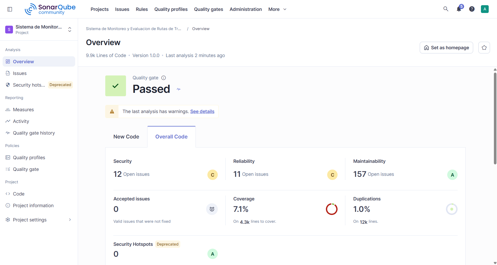
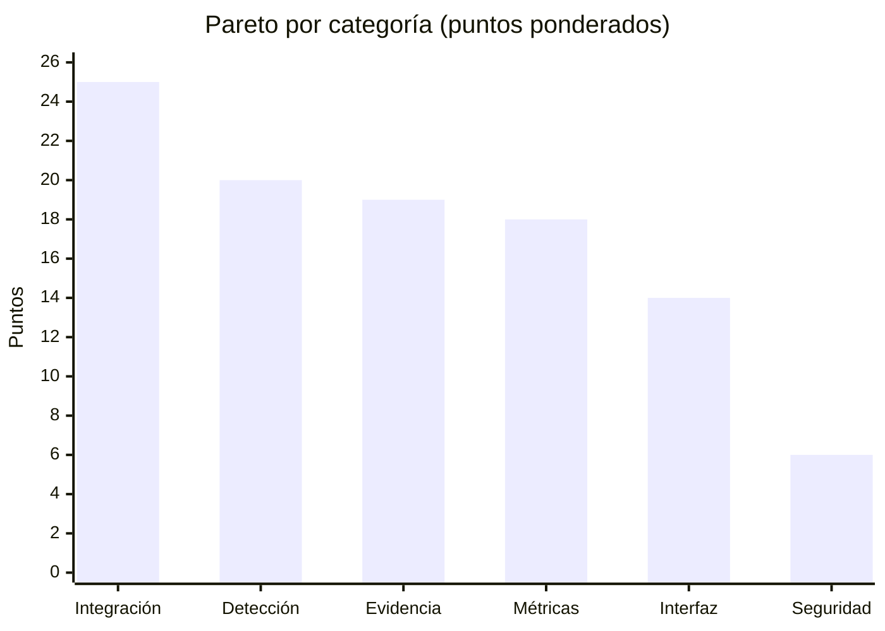
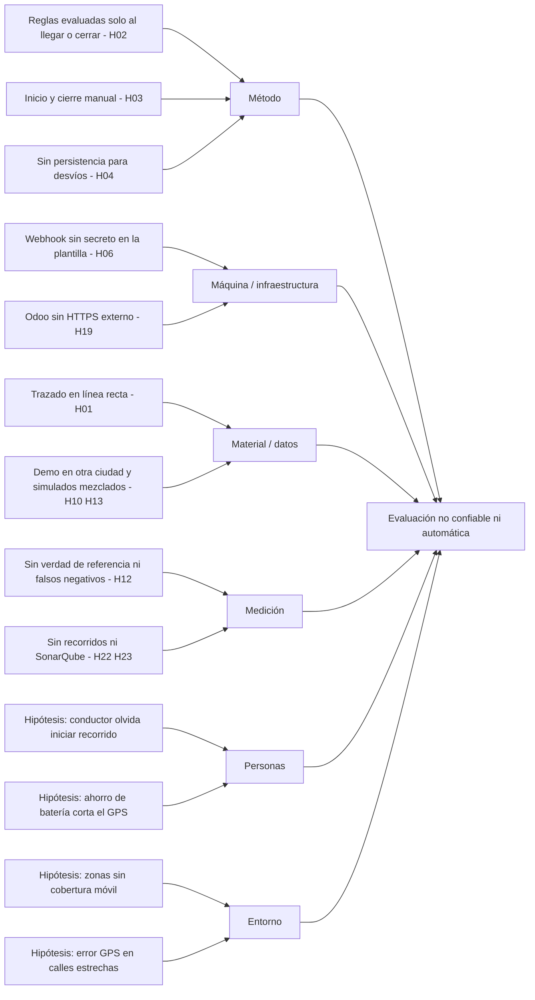
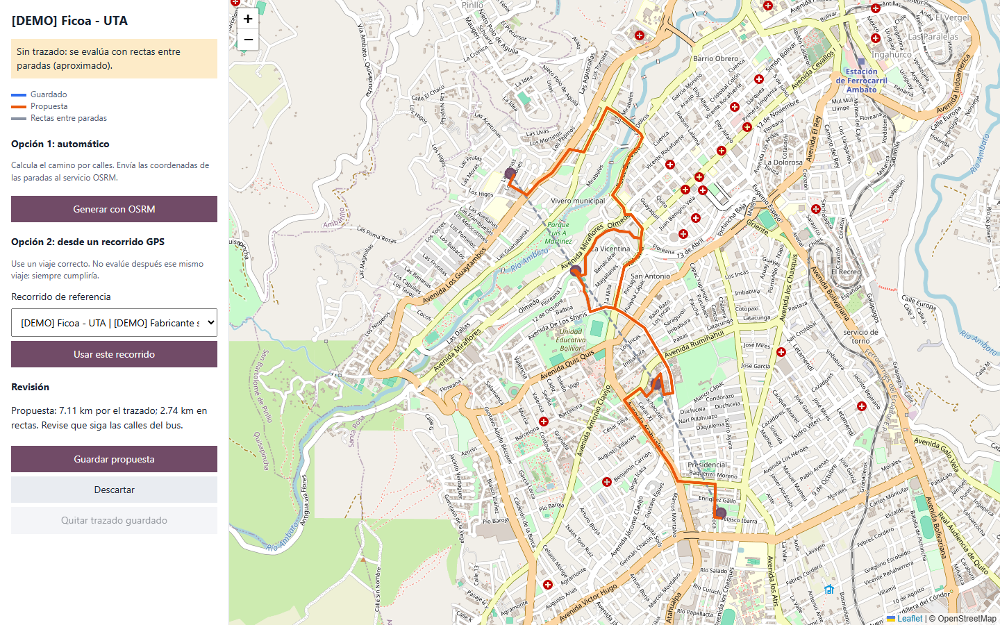
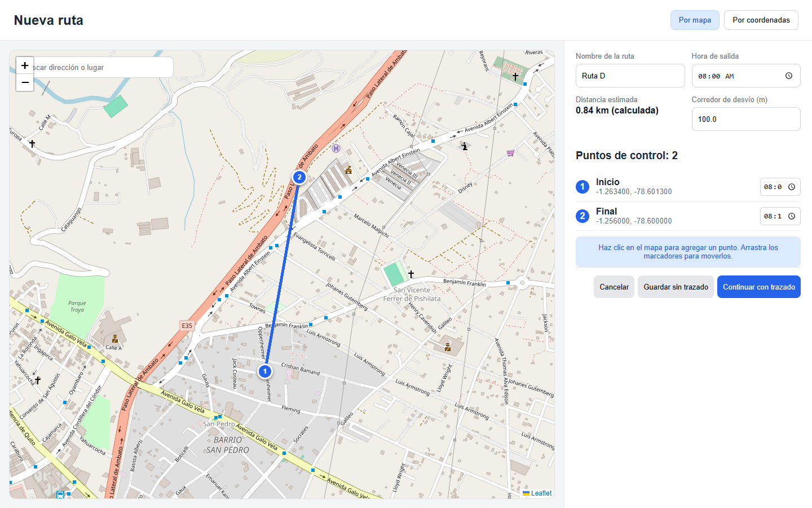
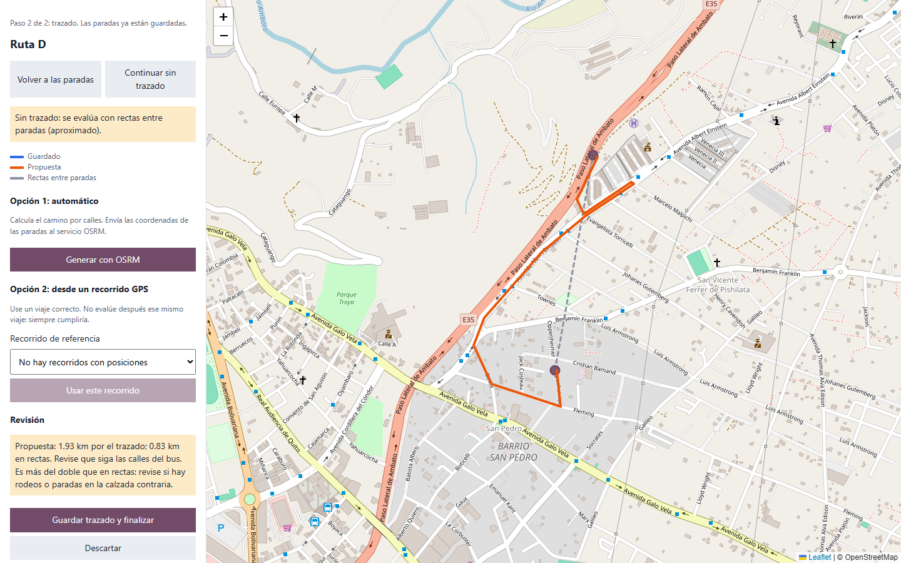
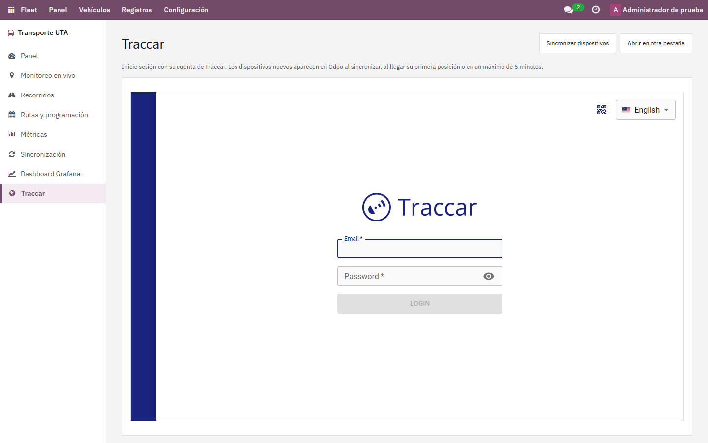

# Informe de mejora continua

**Proyecto:** Sistema de Monitoreo y Evaluación de Rutas de Transporte Universitario (Odoo 16 + Traccar)
**Asignatura:** Gestión de Calidad del Software
**Corte de la línea base:** 27/11/2026
**Estado:** fases Definir, Medir (línea base ejecutada, incluida SonarQube) y Analizar completadas; Mejorar y Controlar planificadas.

## 0. Alcance y fuentes

| Elemento | Referencia |
|---|---|
| Versión inicial (presentada) | `origin/develop`, commit `1aa8ea6`. La rama `develop` local está atrasada (`adeef6b`) |
| Versión actual | `feature/aplicacion_movil`, commit `abf90ba` (añade la PWA "Mi Ruta") |
| Requisitos | `proyectoFinal_GC.pdf`: actividades 1–10 y rúbrica |
| Voz del cliente | 6 observaciones del ingeniero en la presentación del avance |
| Método | Auditoría estática del código, documentos existentes y pruebas automatizadas |

**Verificado el 27/11/2026:** línea base ejecutada sobre el código de `abf90ba` en una copia temporal de la base (sección 2.3). 64 pruebas Pytest aprobadas; `test_revision_pdf.py` no se pudo cargar por falta de `pytz` en el Python local.

**No verificado:** interfaz en navegador, recorridos nuevos con teléfono y conectividad externa. La detección se midió con escenarios simulados.

> **Advertencia:** `addons/fleet_rutas/docs/plan_pdca_mejora_continua.md` contiene cifras sin evidencia (14,8 % de pérdida, 1.250 eventos, resultados "post-PDCA"). El PDF prohíbe presentar datos ficticios como reales. Este informe lo reemplaza; no debe entregarse el anterior.

---

## 1. D — Definir

### 1.1 Problema
La versión inicial monitorea vehículos, pero no permite afirmar de forma objetiva y automática si un recorrido cumple ruta y horario, no informa al pasajero cuándo llegará el bus y presenta los indicadores repartidos y sin evidencia operativa suficiente.

### 1.2 SIPOC

| Proveedor | Entrada | Proceso | Salida | Cliente |
|---|---|---|---|---|
| Teléfono con Traccar Client | Posiciones GPS | Recibir (Traccar) → reenviar a Odoo → asociar a recorrido → aplicar reglas → calcular métricas | Incidencias, métricas, ETA, mapas | Administrador de flota, pasajero, docente evaluador |

### 1.3 Voz del cliente y características críticas (CTQ)
Las metas son propuestas del equipo y deben aprobarse antes de medir.

| ID | Observación | CTQ | Meta propuesta |
|---|---|---|---|
| O1 | Parte de cliente con ubicación y tiempo estimado de llegada | Error absoluto medio del ETA | ≤ 3 min |
| O2 | Incidencias automáticas (fuera de ruta, retraso, etc.) | Precisión y exhaustividad de detección; latencia | ≥ 90 % ambas; ≤ 2 min |
| O3 | Mejorar la interfaz de Odoo | Tareas completadas sin ayuda por usuarios de prueba | ≥ 90 % |
| O4 | Un solo dashboard | Pantallas necesarias para ver los indicadores obligatorios | 1 |
| O5 | Traccar dentro de Odoo | Acceso a Traccar sin salir de Odoo | Sí |
| O6 | Distancias más precisas | Error frente a una distancia de referencia medida | ≤ 2 % |

**Nota técnica sobre O6.** La distancia euclidiana sobre latitud/longitud **no** considera la forma de la Tierra. El código ya usa Haversine (esfera). Para considerar el elipsoide se usa la distancia geodésica WGS84 (Karney o Vincenty). Cerca del ecuador Haversine con R = 6371 km difiere alrededor de +0,56 % norte-sur y −0,11 % este-oeste. El error mayor del sistema es otro: la distancia y el corredor se calculan en **línea recta entre paradas**, no siguiendo las calles. Propuesta: geodésica entre puntos GPS y trazado vial (por ejemplo OSRM) para distancia estimada, corredor y ETA. Confirmar con el ingeniero a qué se refería.

---

## 2. M — Medir

### 2.1 Lista de verificación de cumplimiento (línea base, rama actual)
C = cumple en código/evidencia; P = parcial; N = no cumple; S = sin evidencia de ejecución.

| ID | Requisito | Est. | Falta |
|---|---|---|---|
| R01 | Requisitos RF/RNF con criterios | P | Ampliar: app cliente, ETA, reglas automáticas, metas medibles |
| R02 | Odoo 16 y módulo Fleet | C | Repetir capturas |
| R03 | Servidor Traccar | C | Repetir capturas |
| R04 | Traccar Client en teléfono | S | Enviar y capturar |
| R05 | Conectividad externa con datos móviles | S | Probar sin Wi-Fi |
| R06 | Asociar dispositivo y vehículo | C | |
| R07 | Última posición con fecha | C | |
| R08 | Historial de posiciones | C | |
| R09 | Información de recorridos en Odoo | C | |
| R10 | Mapa de posición y recorrido | C | |
| R11 | Sin duplicados; identificar datos desactualizados | C | |
| R12 | 2 vehículos, 3 rutas, 4 puntos, horarios | P | Demo ubicada en Quito (H13) |
| R13 | Asignación de ruta por fecha y hora | P | H07, H08 |
| R14 | Datos conservados por recorrido | C | |
| R15 | 10 recorridos documentados | N | Ejecutarlos |
| R16 | Detección de retrasos | P | Solo al llegar o cerrar (H02) |
| R17 | Puntos de control incumplidos | P | Solo al cerrar |
| R18 | Desviaciones respecto a corredor | P | H01, H04 |
| R19 | Recorridos incompletos | P | Cierre manual (H03) |
| R20 | Diferencia entre tiempo estimado y real | P | Hay métrica, falta regla de incidencia |
| R21 | Pérdida de señal | C | Cron cada 10 min |
| R22 | Tolerancias definidas y justificadas | P | Fijas en código y sin justificar |
| R23 | 8 métricas de transporte | P | H01, H10 |
| R24 | 4 métricas de calidad de software | P | H12 |
| R25 | Fórmula, fuente, unidad, resultado, interpretación | C | |
| R26 | Dashboard con comparación de rutas y períodos | P | H15 |
| R27 | Pruebas de caja negra | P | Sobre el sistema instalado |
| R28 | Pruebas de caja blanca | C | |
| R29 | Pruebas de integración | P | Mayormente simuladas |
| R30 | Rendimiento con distintos volúmenes | N | Estado previo a la medición; ahora hay una primera medida (2.3), falta la de extremo a extremo |
| R31 | Pruebas automatizadas | C | |
| R32 | Reporte SonarQube | N | Estado al corte; ya ejecutado (2.3), falta interpretar y corregir |
| R33 | Relación con ISO/IEC 25010 | P | Con resultados medidos |
| R34 | 10 o más casos de prueba documentados | C | Añadir casos nuevos |
| R35 | Mejora continua con antes/después | P | Este informe + mediciones |
| R36 | Arquitectura y modelo de datos | P | Diagrama ER y app cliente |
| O1 | App cliente con ETA | P | Hay PWA; falta ETA |
| O2 | Incidencias automáticas | P | H01–H05 |
| O3 | Mejora de interfaz Odoo | N | |
| O4 | Dashboard único | N | |
| O5 | Traccar dentro de Odoo | N | Solo hay Grafana embebido |
| O6 | Distancias más precisas | N | |

### 2.2 Nivel sigma de la línea base
- Oportunidades: 42. C = 14, P = 19, N = 7, S = 2.
- Defecto: todo ítem que no está en C. D = 28.
- Rendimiento = 14/42 = 33,3 %. **DPMO = 666.667**. **Nivel sigma ≈ 1,07** (con desplazamiento de 1,5σ).
- Meta final: máximo 2 ítems fuera de C → DPMO ≤ 47.619, ≈ 3,17σ.

Es un indicador de avance sobre una lista de verificación pequeña, no una capacidad estadística de proceso.

### 2.3 Línea base operativa (ANTES)
Resultados completos en [linea_base/resumen.md](linea_base/resumen.md). Reproducir con `pwsh scripts/linea_base/ejecutar.ps1`. Los resultados esperados se fijaron en `scripts/linea_base/escenarios.json` antes de ejecutar.

| Métrica | Línea base | Meta | Después |
|---|---|---|---|
| Precisión de incidencias (11 escenarios simulados) | 72,7 % (8 VP, 3 FP) | ≥ 90 % | |
| Exhaustividad | 80,0 % (2 FN) | ≥ 90 % | |
| Escenarios con resultado exacto | 6 de 11 (54,5 %) | 11 de 11 | |
| Eventos registrados antes de cerrar el recorrido | 4 de 10 (40 %)¹ | Retraso, desvío y señal en curso | |
| Falsos desvíos en escenarios normales | 2 de 4 (E02, E08) | 0 | |
| Posiciones de Traccar presentes en Odoo | 4 de 24 (16,7 %)² | ≥ 95 % | |
| Error de distancia estimada contra la vía real | Sin referencia; la guardada es exactamente la recta entre paradas | ≤ 2 % | |
| Haversine frente a geodésica WGS84 | +0,37 % a +0,49 % | Informativo | |
| p95 dashboard, solo consultas | 59 ms | ≤ 2 s | |
| p95 mapa: 100 / 1.000 / 10.000 posiciones | 17 / 42 / 281 ms | ≤ 2 s | |
| p95 cálculo de métricas | 17 / 83 / 556 ms | ≤ 2 s | |
| p95 ingerir una posición | 10 / 23 / 186 ms | Que no crezca con el historial | |
| Cobertura de líneas Python (aproximada³) | 8,2 % | ≥ 70 % en lógica propia | |
| Complejidad ciclomática | media 6,92; 12 funciones > 15; máxima 105 | ≤ 15 | |
| MAE del ETA | No existe ETA | ≤ 3 min | |
| SonarQube: seguridad (incidencias abiertas / calificación) | 12 / C | 0 / A | |
| SonarQube: fiabilidad | 11 / C | 0 críticas / A | |
| SonarQube: mantenibilidad | 157 / A | Reducir, mantener A | |
| SonarQube: cobertura (4,3 mil líneas por cubrir) | 7,1 % | ≥ 70 % en lógica propia | |
| SonarQube: duplicación (12 mil líneas) | 1,0 % | ≤ 3 % (cumple) | |
| SonarQube: Security Hotspots | 0 | 0 | |

1. La pérdida de señal se comprobó llamando al método del cron; en operación puede tardar hasta 10 min.
2. Datos reales del 17/11 comparados con la base actual. La causa probable es H06, pero no está demostrada: la base pudo configurarse o regenerarse después.
3. Trazador propio, no `coverage.py`. Las pruebas que extraen métodos del código pueden alterar la cifra.

El rendimiento se midió en el mismo equipo, sin red externa ni dibujo en el navegador.

**SonarQube** (primer análisis, 27/11/2026, 9,9 mil líneas de código, versión 1.0.0 del proyecto; el código de `addons` es el de `abf90ba`). Evidencia: [captura](linea_base/sonarqube_antes.png).

El Quality Gate figura como **Passed**, pero no demuestra que se cumplan las metas del equipo: la cobertura es 7,1 % y hay incidencias de seguridad y fiabilidad con calificación C. La puerta predeterminada de SonarQube evalúa el código nuevo, que en un primer análisis no aporta comparación; confirmar sus condiciones en la pestaña *Quality gate*. El análisis reportó advertencias aún sin revisar.

**Datos actuales de la base** (todos los recorridos son simulados): 15 recorridos, 740 posiciones (736 simuladas), 34 incidencias, 12 métricas, 0 incidencias validadas y 0 métricas con exactitud de sincronización. Los promedios del dashboard (cumplimiento 50 %, puntualidad 68,75 %) **no son resultados operativos**.

**Interfaz:** capturas, 20 observaciones y 5 tareas de usabilidad en [LINEA_BASE_INTERFAZ.md](usabilidad/LINEA_BASE_INTERFAZ.md). Las pruebas con participantes están pendientes.

#### Clasificación de las 12 incidencias de seguridad (4 medias, 8 bajas)
Clasificación propuesta tras leer cada línea; el equipo debe aprobarla. Ninguna se ha cambiado todavía en SonarQube ni en el código.

| Cant. | Regla | Ubicación | Dictamen | Acción propuesta |
|--:|---|---|---|---|
| 4 | "password" detectado | `mobile_views.xml:44`, `fleet_rutas/.../res_config_settings_views.xml:105,107`, `fleet_traccar/.../res_config_settings_views.xml:30` | Falso positivo: es el atributo que enmascara el campo, no una credencial escrita | Marcar *False Positive* con esta justificación |
| 3 | HTTP inseguro | `fleet_traccar_sync.py:115`, `traccar_service.py:88`, `fleet_traccar/.../res_config_settings.py:10` | Riesgo aceptable solo para la red interna de Docker (`http://traccar:8082`) | Marcar *Accepted*; exigir HTTPS si Traccar está en otro equipo |
| 2 | Falta integridad de recurso externo | `static/mobile/index.html:11,13` | Válido: Leaflet se carga desde unpkg sin verificación | Añadir `integrity` y `crossorigin` |
| 3 | Uso de `pytz` | `fleet_metricas.py:301`, `fleet_posicion_gps.py:10`, `fleet_ruta.py:99` | Consistencia; Odoo 16 también usa `pytz` | Aceptar o migrar a `zoneinfo` con pruebas de horarios |

#### Clasificación de las 11 incidencias de fiabilidad (4 medias, 7 bajas)

| Cant. | Regla | Ubicación | Dictamen | Acción propuesta |
|--:|---|---|---|---|
| 3 | `aria-selected` en rol botón | `static/mobile/index.html:24` | Válida (accesibilidad) | `role="tablist"` en la barra y `role="tab"` en los botones |
| 3 | Uso de `pytz` | Las mismas tres de seguridad | Compartidas entre ambas categorías | La decisión de la tabla de seguridad |
| 1 | Igualdad con decimales | `fleet_algoritmos.py:109` | Menor: protege contra un segmento de longitud cero | Usar un umbral pequeño y probar el caso límite |
| 4 | `replaceAll` / `codePointAt` | `app.js:185-186`, `fleet_ui_fields.js:32` | Estilo; no se identificó un fallo | Corregir o aceptar con justificación |

Entre seguridad y fiabilidad hay **20 incidencias distintas**, porque 3 se cuentan en ambas.

**Límites del análisis:** no señaló H20 ni H21 (contraseña fija en Compose, que está fuera de `sonar.sources`, y CSRF desactivado). Cero *hotspots* no demuestra que el sistema sea seguro. Además, en la revisión manual, `mobile_views.xml:44` incluye la clave privada Web Push como campo invisible, por lo que se envía al navegador del administrador, en contra de lo que afirma `docs/APLICACION_MOVIL.md`; falta comprobarlo en ejecución.

---

## 3. A — Analizar

### 3.1 Catálogo de hallazgos
Severidad: Alta (5) compromete un requisito o la veracidad de resultados; Media (3) lo limita; Baja (1) es menor.

| ID | Categoría | Sev. | Hallazgo | Evidencia |
|---|---|---|---|---|
| H01 | Detección | Alta | Corredor, desviación y distancia estimada usan rectas entre paradas | `fleet_posicion_gps.py:152-155`, `fleet_metricas.py:192`, editor en `mapa.py` |
| H02 | Detección | Alta | Si el bus no llega, no hay incidencia de retraso u omisión hasta cerrar | `fleet_posicion_gps.py:258`, `fleet_ruta.py:516` |
| H03 | Detección | Alta | Inicio y cierre manuales; sin ellos no se evalúa el recorrido | `fleet_ruta.py:435-506`, `scheduled_actions.xml` |
| H04 | Detección | Media | Un solo punto fuera dispara desvío; solo una incidencia abierta por recorrido | `fleet_posicion_gps.py:160-212` |
| H05 | Detección | Baja | El exceso de velocidad nunca se genera; severidad fija en retraso y omisión | `fleet_incidencia.py:137` (sin llamadas) |
| H06 | Integración | Alta | `.env.example` no define `TRACCAR_WEBHOOK_SECRET`; sin él el webhook responde 401 y queda el sondeo de la última posición cada minuto | `.env.example`, `traccar_webhook.py:38-45` |
| H07 | Integridad | Alta | "Asignar ruta" cambia la ruta de un recorrido ya en curso | `mapa.py:480-494` |
| H08 | Integridad | Media | Editar una ruta borra sus paradas; la restricción lo impide si hay historial | `mapa.py:397`, `fleet_cumplimiento_parada.py:29` |
| H09 | Integración | Baja | `bus.bus.sendone` no existe en Odoo 16 y el error se silencia | `fleet_traccar_sync.py:147`, `traccar_webhook.py:205` |
| H10 | Métricas | Alta | Los promedios del dashboard mezclan recorridos simulados y reales | `fleet_dashboard.js:476-490` |
| H11 | Métricas | Alta | Método sin uso con valores fijos (88.6, 94.2, 98.1…) | `fleet_metricas.py:287-342` |
| H12 | Métricas | Media | Respuesta mide solo el cálculo; exactitud compara contra copia propia; detección sin falsos negativos | `fleet_metricas.py:241-271` |
| H13 | Datos | Alta | El XML de demo usa coordenadas de Quito y vehículos "online" ficticios (las rutas de la base actual sí están en Ambato) | `fleet_rutas_demo.xml`, `linea_base/datos_actuales.json` |
| H14 | Documentación | Alta | PDCA anterior con cifras no verificadas | `plan_pdca_mejora_continua.md` |
| H15 | Interfaz | Media | Indicadores repartidos en Panel, Métricas, Grafana y menú nativo; comparación por períodos limitada | `fleet_dashboard.js:6-14`, `menu_views.xml` |
| H16 | Interfaz | Media | Organización y colores observados por el ingeniero (O3) | Observación |
| H17 | Integración | Media | La web de Traccar no está integrada en Odoo | `fleet_dashboard.js` |
| H18 | Cliente | Alta | La app no calcula ETA ni próxima parada | `app.js`, `mobile.py:87-121` |
| H19 | Conectividad | Media | El túnel publica solo el receptor GPS; la PWA necesita Odoo por HTTPS | `docker-compose.tunnel.yml` |
| H20 | Seguridad | Media | Contraseña de administrador de Traccar fija en Compose y contraseña por defecto en Grafana | `docker-compose.yml:118,242` |
| H21 | Seguridad | Media | Rutas POST que escriben datos con CSRF desactivado | `mapa.py:79,352,458` |
| H22 | Evidencia | Alta | Sin los 10 recorridos ni GPS externo demostrado | Revisión 04/11 |
| H23 | Evidencia | Alta | SonarQube sin ejecutar y sin informe de cobertura | `sonar-project.properties` |
| H24 | Pruebas | Media | Sin pruebas Odoo completas ni de volumen; dependencias de prueba no instaladas localmente | `tests/` |
| H25 | Repositorio | Baja | Archivos temporales versionados | `tmp/pdfs/` |
| H26 | Integración | Alta | La instancia en ejecución no carga `fleet_rutas` ni `fleet_reports`; módulo instalado 16.0.1.0.0, código 16.0.2.0.0, `portal` sin instalar, contenedor `odoo:16` sin `pywebpush`; webhook responde 404 | Log de Odoo y consulta del 27/11 |
| H27 | Rendimiento | Media | Ingerir una posición pasa de 10 a 186 ms (p95) entre 100 y 10.000 posiciones del recorrido | `linea_base/resumen.md` |
| H28 | Detección | Baja | Omitir una parada intermedia genera además "incompleto" aunque se llegue al destino (según la definición de los escenarios) | E05, `fleet_ruta.py:523` |

### 3.2 Pareto de hallazgos
Frecuencia ponderada = suma de severidades. Son hallazgos de auditoría, **no fallos observados en operación**; los pesos son juicio del equipo.

| Categoría | Hallazgos | Puntos | % | % acumulado |
|---|---|---:|---:|---:|
| Integración, integridad, conectividad y rendimiento | H06–H09, H19, H26, H27 | 25 | 24,5 | 24,5 |
| Detección de incidencias | H01–H05, H28 | 20 | 19,6 | 44,1 |
| Evidencia, pruebas, documentación y repositorio | H14, H22–H25 | 19 | 18,6 | 62,7 |
| Métricas y datos | H10–H13 | 18 | 17,6 | 80,4 |
| Interfaz y cliente | H15–H18 | 14 | 13,7 | 94,1 |
| Seguridad | H20, H21 | 6 | 5,9 | 100 |
| **Total** | 28 | **102** | 100 | |

**Lectura:** la distribución es pareja; no hay un 20 % de causas que explique el 80 %. Las cuatro primeras categorías suman 80,4 %.

**Errores de detección observados en los escenarios (simulados)**

| Causa | Escenario | Errores | % | % acumulado |
|---|---|--:|--:|--:|
| Corredor en línea recta (H01) | E02 | 1 | 20 | 20 |
| Sin persistencia del desvío (H04) | E08 | 1 | 20 | 40 |
| Una sola incidencia abierta (H04) | E07 | 1 | 20 | 60 |
| Definición de incompleto (H28) | E05 | 1 | 20 | 80 |
| Sin retraso en tiempo real (H02) | E11 | 1 | 20 | 100 |

Con 5 errores y un escenario diseñado para cada debilidad, la muestra **no permite un Pareto válido**; sirve como comparación antes/después. Repetirlo con los recorridos reales.

### 3.3 Ishikawa
**Efecto:** el sistema no evalúa de forma confiable ni automática el cumplimiento de rutas y horarios. Las ramas son causas encontradas en el código (con ID) o hipótesis por comprobar.

### 3.4 Cinco porqués: falsos desvíos esperados
1. ¿Por qué se marcaría desvío en un recorrido normal? Porque el bus queda a más de 100 m del corredor.
2. ¿Por qué queda lejos si va por su vía? Porque el corredor es la recta entre paradas.
3. ¿Por qué es una recta? Porque la ruta solo almacena paradas, no su trazado.
4. ¿Por qué no hay trazado? Porque el modelo y el editor no lo incluyen.
5. **Causa raíz:** el requisito de "trazado o corredor geográfico de referencia" se implementó con la aproximación mínima y no se validó con recorridos reales.

### 3.5 AMFE (FMEA)
S, O, D de 1 a 10, estimados por el equipo; revisar tras las pruebas. NPR = S×O×D.

| Modo de fallo | Efecto | S | O | D | NPR | Acción |
|---|---|--:|--:|--:|--:|---|
| Webhook rechaza posiciones | Historial incompleto, falsas pérdidas de señal | 9 | 6 | 7 | 378 | Secreto obligatorio y prueba de salud |
| Desvío falso en curvas | Incidencias erróneas | 8 | 8 | 5 | 320 | Trazado vial y persistencia |
| Recorrido no iniciado | No hay evaluación | 9 | 5 | 6 | 270 | Inicio y cierre automáticos |
| Bus no llega y no hay alerta | Pasajero y administrador sin aviso | 8 | 5 | 6 | 240 | Cron de retraso |
| Simulados en indicadores | Resultados engañosos | 9 | 5 | 5 | 225 | Excluir por defecto |
| Ruta cambiada en curso | Historial inconsistente | 8 | 3 | 7 | 168 | Bloquear |
| ETA con GPS antiguo | Pasajero pierde el bus | 7 | 5 | 4 | 140 | No mostrar ETA si > 120 s |

---

## 4. I — Mejorar (ciclos PDCA)

### Ciclo 0 — realizado (04/11/2026)
- **Planificar:** reproducir ocho fallos de sincronización, cálculo y diagnóstico.
- **Hacer:** correcciones F01–F07 (`docs/2026-11-04/RESULTADOS_Y_CAMBIOS.md`).
- **Verificar:** antes 8 de 8 regresiones fallaban (`regresiones_antes.xml`); después 51 de 51 pruebas aprobadas (`pruebas_despues.xml`). Ejemplos: integridad GPS en el caso controlado pasó de 100 % a 10 %; retraso de 368 min erróneos a 8 min.
- **Actuar:** conservar las regresiones en la suite.

### Ciclo 0b — realizado (27/11/2026): despliegue de la versión actual
Hallazgos posteriores a la línea base; no modifican su Pareto.
- **Planificar:** resolver H26. Al construir la imagen, Odoo no arrancaba: `module 'lib' has no attribute 'GEN_EMAIL'`. Causa: `pywebpush` arrastraba `py-vapid 1.9.6`, que instalaba `cryptography 50.0.2`, incompatible con `pyOpenSSL 20.0.1` de la imagen. La prueba en copia usó la imagen sin esa dependencia y no lo detectó.
- **Hacer:** fijar `cryptography==3.3.2` en `config/Dockerfile.odoo` (pip elige `py-vapid 1.9.2`), añadir una importación de comprobación en la construcción, definir el secreto del webhook y actualizar módulos con respaldo previo.
- **Verificar:** antes, `base` y `web` no cargaban; después, inicio de sesión HTTP 200, `fleet_rutas` 16.0.2.0.0, webhook 401 sin token y 200 con token, manifiesto PWA 200, firma VAPID y cifrado push correctos, sin errores en el log tras 75 s. Se conservaron los conteos: 15 recorridos, 740 posiciones, 34 incidencias, 12 métricas.
- **Actuar:** probar siempre la imagen que se despliega. Pendiente: GPS real tras el cambio, envío push a un teléfono y revisar la antigüedad de `cryptography 3.3.2`.

### Ciclo 1a — realizado (27/11/2026): pérdida de posiciones del reenvío (H29)
H29 (Integración, severidad alta) se descubrió después de la línea base y no modifica su Pareto.
- **Síntoma:** con el teléfono de prueba, desde las 00:59 UTC del 28/11 Traccar tenía 50 posiciones y Odoo 4. Un compañero reportó un problema parecido en el despliegue en la nube (pendiente de confirmar que tenga la misma causa).
- **Planificar (causa):** una posición reenviada llegó con `id = 0`; Odoo la guardaba como identificador único y trataba las siguientes con 0 como duplicadas. Que todas las perdidas llegaran con 0 es una deducción, coherente con la reproducción.
- **Hacer:** el 0 se trata como "sin ID"; los duplicados sin ID se reconocen por vehículo, segundo y coordenadas (`buscar_equivalente`); cuando el cron o el historial traen el ID real se completa en el mismo registro; los conflictos de concurrencia ya no descartan la posición en el webhook.
- **Verificar:** misma prueba de integración en una copia de la base ([antes](ciclo_webhook/antes.json), [después](ciclo_webhook/despues.json)): antes 4 de 9 casos correctos y 0 de 10 posiciones reenviadas guardadas; después 9 de 9 y 10 de 10. Pytest: 64 aprobadas más 4 de `test_revision_pdf.py` ejecutadas sustituyendo `pytz`. Reproducir: `pwsh scripts/pruebas/prueba_posiciones.ps1`.
- **Primera comprobación real (teléfono en la red local, 28/11 03:58 UTC):** 2 de 2 posiciones distintas de Traccar aparecieron en Odoo, ambas por el reenvío (sin ID), unos 3 s después y sin errores. Muestra pequeña y sin recorrido en curso; no equivale a un recorrido documentado.
- **Actuar:** **pendiente** comparar Traccar y Odoo con un recorrido real posterior al cambio y probar en la nube. La concurrencia entre reenvío y cron no está cubierta por la prueba. Las posiciones perdidas pueden recuperarse con la sincronización de historial de cada recorrido.

### Ciclo 1 — Detección automática confiable (O2, O6)
| Fase | Contenido |
|---|---|
| P | Definir tolerancias y escenarios: puntual, atrasado, parada omitida, desvío, incompleto, sin señal. Medir línea base |
| D | Actualizar módulos e imagen (H26); secreto del webhook (H06); costo de ingestión (H27); regla de incompleto (H28); trazado vial por ruta y distancia geodésica (H01); desvío tras 3 posiciones seguidas o 60 s, un evento por episodio (H04); cron cada minuto para retraso y omisión (H02); inicio y cierre automáticos por horario y geocerca (H03); velocidad (H05); bloquear H07 y H08 |
| C | Precisión, exhaustividad, latencia y falsos desvíos frente a la línea base |
| A | Fijar umbrales en Ajustes; convertir cada fallo en prueba de regresión |

Tolerancias iniciales a justificar con datos: retraso 5 min (ejemplo del PDF); radio de parada 50 m; corredor 100 m; pérdida de señal 120 s.

### Ciclo 1b — realizado (28/11/2026): trazado vial y distancia geodésica (H01, O6)
- **Planificar:** evaluar desvíos y distancia contra el camino real y no contra rectas entre paradas.
- **Hacer:** un trazado por ruta con dos orígenes (OSRM o recorrido GPS), vista previa antes de guardar, pérdida de vigencia si cambian las paradas, rectas como respaldo; usado en desvíos, métricas, mapa del recorrido y app del pasajero; distancia recorrida geodésica WGS84; formularios con token CSRF y Leaflet con verificación de integridad en la página nueva.
- **Verificar:** 15 de 15 casos de integración ([resultados](ciclo_trazado/pruebas.json), `pwsh scripts/pruebas/prueba_trazado.ps1 -OsrmReal`) y 76 pruebas Pytest (sin `test_revision_pdf.py`). Los mismos 11 escenarios simulados, declarando en E02 su vía real ([después](ciclo_trazado/escenarios.json)):

| Métrica | Antes | Después |
|---|--:|--:|
| Precisión | 72,7 % | 80,0 % |
| Exhaustividad | 80,0 % | 80,0 % |
| Escenarios exactos | 6 de 11 | 7 de 11 |
| Desviación calculada en E02 (vía curva correcta) | 24,6 % | 0 % |

La mejora se debe a E02, diseñado para esta debilidad, y supone un trazado correcto; E05, E07, E08 y E11 siguen fallando.

- **OSRM real sobre las rutas de demostración (propuestas, no guardadas):**

| Ruta | Rectas (km) | OSRM (km) |
|---|--:|--:|
| Centro - UTA | 2,57 | 4,82 |
| Ficoa - UTA | 2,74 | 7,11 |
| Huachi - UTA | 2,38 | 3,36 |

OSRM calcula un camino para automóvil que puede incluir rodeos: **cada trazado debe revisarse**. No hay todavía una distancia medida en campo para calcular el error (meta ≤ 2 %).

- **Rendimiento:** calcular métricas de 1.000 posiciones contra 500 vértices tardó 567 ms (antes 49 ms con un trazado de 4 puntos). Los trazados de OSRM observados tienen 27 a 73 vértices; falta medir 10.000 posiciones.
- **Actuar:** **pendiente** definir los trazados reales, validar con recorridos distintos al de referencia y optimizar si el p95 supera 2 s.

### Ciclo 1c — realizado (28/11/2026): rodeos de OSRM en vías de doble calzada
- **Síntoma:** al probar una ruta real de 5 paradas, el trazado sobrepasaba el último punto y medía 42,0 km frente a 4,08 km en rectas.
- **Causa verificada:** las paradas estaban junto a la calzada de sentido contrario; OSRM avanzaba hasta un retorno en cada tramo.
- **Hacer:** buscar calzadas a 40 m o menos de cada parada y elegir la combinación de menor recorrido total (`nearest` y `table` de OSRM); aviso en la vista cuando el trazado supera el doble de las rectas.
- **Verificar:** la misma ruta pasó a 5,77 km (propuesta con el servicio real); 79 pruebas Pytest, 3 de ellas nuevas para la selección, y 15 de 15 casos de integración. En las rutas de demostración: Centro 4,82 → 3,72 km, Ficoa 7,11 → 6,91 km, Huachi 3,36 → 2,89 km.
- **Actuar:** revisar cada propuesta; el ajuste elige el camino más corto, que puede no ser el del bus. Los trazados guardados antes del cambio deben regenerarse. Las cifras OSRM del ciclo 1b son anteriores a esta corrección y `ciclo_trazado/pruebas.json` contiene las nuevas.

### Ciclo 1d — realizado (28/11/2026): trazado dentro de la creación de rutas
- **Planificar:** el usuario esperaba el trazado al marcar las paradas y encontraba los botones separados.
- **Hacer:** el editor ofrece **Guardar sin trazado** y **Continuar con trazado**; el segundo abre el paso 2 con la propuesta de OSRM calculada, sin guardarla, y opciones para volver o terminar. Al guardar paradas se conserva la distancia de un trazado aún vigente. Botones Trazado y Editar ruta juntos.
- **Verificar:** recorrido automatizado en una copia de la base (editor → paso 2 → guardar) sin errores de JavaScript ni de Odoo; 79 pruebas Pytest. Falta la prueba con usuarios.

| Paradas | Trazado |
|---|---|
|  |  |

### Ciclo 1e — realizado (28/11/2026): editar rutas con historial (H08)
- **Planificar:** editar una ruta con recorridos registrados fallaba (`ForeignKeyViolation`) porque el editor borraba todas las paradas.
- **Hacer:** conservar las paradas sin cambios; sustituir las modificadas archivando las que tengan historial; impedir cambios de paradas con un recorrido en curso; guardar ruta y paradas como una sola operación; proteger la edición y el borrado directos; mostrar cada recorrido con las paradas que registró. De paso, una tolerancia de 0 minutos ya no se convierte en 5.
- **Verificar:** la misma prueba en una copia de la base: [antes](ciclo_editar_ruta/antes.json) 1 comprobación correcta y varios grupos interrumpidos por error; [después](ciclo_editar_ruta/despues.json) 17 de 17. `pwsh scripts/pruebas/prueba_editar_ruta.ps1`.
- **Límite:** las paradas se conservan, pero el trazado de referencia no tiene versiones: reprocesar posiciones de un recorrido antiguo usa el trazado actual. Las métricas ya calculadas no cambian.

### Ciclo 1f — realizado (28/11/2026): reglas de desvío e incompleto (H04, H28)
- **Planificar:** corregir E05, E07 y E08: un punto aislado generaba desvío, solo se registraba un desvío por recorrido y omitir una parada intermedia marcaba "incompleto".
- **Hacer:** desvío confirmado con 3 lecturas seguidas fuera del corredor de 100 m, o 2 que abarquen 60 s; el episodio termina con 2 lecturas dentro; una incidencia por episodio, sin duplicarse al reprocesar; el cumplimiento y la marca "con desvío" usan episodios confirmados; "incompleto" solo sin llegada al destino; en rutas circulares el destino no cuenta al salir.
- **Justificación de tolerancias:** 3 lecturas descartan saltos aislados del GPS; el límite de 60 s cubre envíos poco frecuentes; 2 lecturas de retorno evitan dividir un desvío por oscilar en el borde. Son valores iniciales, **pendientes de ajustar con recorridos reales**. Consecuencia: un desvío más corto que ese mínimo no se registra.
- **Verificar:** 17 de 17 casos de integración ([resultados](ciclo_reglas/pruebas.json), `pwsh scripts/pruebas/prueba_reglas.ps1`) y 88 pruebas Pytest (sin `test_revision_pdf.py`). Mismos 11 escenarios simulados ([después](ciclo_reglas/escenarios.json)):

| Métrica | Línea base | Con trazado | Con reglas |
|---|--:|--:|--:|
| Precisión | 72,7 % | 80,0 % | 100 % |
| Exhaustividad | 80,0 % | 80,0 % | 90,0 % |
| Escenarios exactos | 6 de 11 | 7 de 11 | 10 de 11 |
| Eventos registrados en curso | 4 de 10 | 4 de 10 | 5 de 10 |

- **Lectura:** los escenarios se diseñaron para estas debilidades; el resultado muestra que se corrigieron, no la precisión en operación. Falla E11 (retraso sin llegada), que corresponde al siguiente bloque (H02).
- **Rendimiento:** con 10.000 posiciones, ingerir una tardó como máximo 202 ms dentro del corredor y 257 ms fuera (10 muestras; línea base p95 186 ms). H27 sigue pendiente.
- **Actuar:** las incidencias anteriores no se recalculan; validar con recorridos reales.

### Ciclo 1g — realizado (28/11/2026): incidencias en tiempo real y recorridos automáticos (H02, H03)
- **Planificar:** alertar sin esperar al cierre y no depender de iniciar y cerrar a mano.
- **Hacer:** tarea cada minuto, que además revisa la señal perdida de los recorridos reales en curso (antes solo cada 10 min):

| Regla | Condición |
|---|---|
| Inicio automático | Vehículo en el radio del origen entre 5 min antes y 60 min después de la hora programada |
| Sin iniciar | Pasada la tolerancia del origen (hasta 12 h) |
| Retraso en curso | Sin llegada y pasada la tolerancia de la parada |
| Omisión en curso | Se visitó una parada posterior; se resuelve si luego se visita |
| Cierre por llegada | Destino alcanzado y al menos la mitad de las intermedias |
| Cierre vencido | 60 min tras el fin previsto y 15 min sin posiciones |

  Una incidencia por recorrido, parada y tipo. Los recorridos **simulados** no se modifican. El inicio y cierre automáticos se desactivan con el parámetro `fleet_rutas.recorridos_automaticos = 0`.
- **Verificar:** 26 de 26 casos con hora controlada ([resultados](ciclo_automatico/pruebas.json), `pwsh scripts/pruebas/prueba_automatico.ps1`; en la primera ejecución falló 1 por una expectativa errónea de la prueba, que contaba un retraso legítimo de otra parada). Mismos 11 escenarios simulados ([después](ciclo_automatico/escenarios.json)):

| Métrica | Línea base | Con reglas | En tiempo real |
|---|--:|--:|--:|
| Precisión | 72,7 % | 100 % | 100 % |
| Exhaustividad | 80,0 % | 90,0 % | 100 % |
| Escenarios exactos | 6 de 11 | 10 de 11 | 11 de 11 |
| Eventos registrados en curso | 4 de 10 | 5 de 10 | 7 de 10 |

  Los 3 eventos restantes (E10) solo se conocen al cerrar el recorrido. En los escenarios la revisión se invoca al final de la traza: **no miden la latencia**, que en operación depende de la tarea de cada minuto.
- **Actuar:** pendiente validar con recorridos reales y ajustar los plazos.

### Ciclo 2 — Aplicación del pasajero con ETA (O1)
| Fase | Contenido |
|---|---|
| P | Criterio: MAE ≤ 3 min; sin ETA si la posición tiene más de 120 s |
| D | Proyectar el bus sobre el trazado; distancia restante a cada parada; velocidad reciente con respaldo de tiempos históricos; próxima parada, ETA y estado "a tiempo / atrasado"; publicar Odoo por HTTPS (H19) |
| C | Registrar ETA y llegada real en cada recorrido; probar en teléfono |
| A | Ajustar el modelo según el error por ruta y horario |

La app es una PWA servida por Odoo. Confirmar con el ingeniero que cumple "aplicación móvil sencilla aparte".

### Ciclo 3 — Experiencia en Odoo (O3, O4, O5)
| Fase | Contenido |
|---|---|
| P | Boceto, paleta y 5 tareas de usabilidad; medir antes |
| D | Un dashboard con mapa, 8 métricas de transporte, 4 de calidad, tendencias, comparación entre rutas y períodos y filtro real/simulado (H10, H15); eliminar H11; reorganizar menús (H16); pestaña Traccar (H17) |
| C | Repetir las tareas; contrastar cada indicador con una consulta SQL; capturas antes/después |
| A | Guía de estilo y pruebas visuales |

Integración de Traccar: probar primero un `iframe` autenticado. Puede bloquearse por cookies o por contenido mixto HTTP/HTTPS; en ese caso usar un proxy inverso en el mismo dominio. No incluir credenciales de administrador en la URL.

### Ciclo 3a — realizado (28/11/2026): Traccar dentro de Odoo (O5, H17)
- **Planificar:** consultar y administrar Traccar sin salir de Odoo y que sus dispositivos aparezcan solos. La creación automática de vehículos ya existía; ignoraba el nombre, reactivaba el seguimiento desactivado y no señalaba dispositivos ausentes.
- **Hacer:** pestaña **Traccar** en el dashboard (la web de Traccar embebida, con enlace a otra pestaña); parámetro opcional de URL para el navegador; nombre del dispositivo; respeto del seguimiento desactivado; estado "No disponible en Traccar"; los vehículos archivados no se duplican.
- **Verificar:** 16 de 16 casos de integración en una copia de la base con un Traccar simulado ([resultados](ciclo_traccar/pruebas.json), `pwsh scripts/pruebas/prueba_dispositivos.ps1`). La pantalla de acceso de Traccar se muestra dentro de Odoo:

- **Actuar:** **pendiente** iniciar sesión dentro de la pestaña, crear un dispositivo real y verlo en Odoo, y probar el despliegue en la nube (con HTTPS hace falta una URL HTTPS de Traccar). La sesión de Traccar es independiente de la de Odoo.

### Ciclo 4 — Evidencia y calidad (actividades 5 y 9)
| Fase | Contenido |
|---|---|
| P | Quality Gate: 0 bugs y vulnerabilidades críticas, cobertura ≥ 70 % en lógica propia, duplicación ≤ 3 % |
| D | SonarQube (H23); pruebas Odoo y de rendimiento (H24); credenciales y CSRF (H20, H21); demo en Ambato (H13); retirar cifras ficticias y temporales (H14, H25); 10 recorridos (H22) |
| C | Reporte antes/después, p50 y p95, matriz de casos |
| A | Ejecutar pruebas y análisis en cada integración |

Distribución sugerida de los 10 recorridos (entre 3 rutas):

| # | Ruta | Escenario | Resultado esperado | Obtenido | Origen (real/simulado) | Evidencia |
|--:|---|---|---|---|---|---|
| 1–3 | 1, 2, 3 | Puntual | Sin incidencias | | | |
| 4–5 | 1, 2 | Atrasado | Retraso | | | |
| 6 | 3 | Parada omitida | Omisión | | | |
| 7–8 | 1, 3 | Desvío | Desviación | | | |
| 9 | 2 | Pérdida de señal | Señal perdida | | | |
| 10 | 3 | Incompleto | Incompleto | | | |

---

## 5. C — Controlar

| Control | Frecuencia | Responsable | Reacción |
|---|---|---|---|
| Pytest y verificación de fuentes | Cada integración | Por asignar | No integrar si falla |
| Quality Gate SonarQube | Cada integración | Por asignar | Corregir antes de integrar |
| Estado del webhook y posiciones perdidas | Cada recorrido | Por asignar | Revisar secreto, túnel y teléfono |
| Gráfico p de recorridos con incidencia | Diario con datos | Por asignar | Investigar puntos fuera de límites (interpretar con al menos 20 muestras) |
| Error del ETA | Semanal | Por asignar | Recalibrar |
| Lista de verificación y DPMO | Fin de cada ciclo | Por asignar | Repriorizar |

## 6. Relación con ISO/IEC 25010

| Característica | Hallazgos | Evidencia a producir |
|---|---|---|
| Adecuación funcional | H01–H05, H18, H28 | Precisión, exhaustividad, MAE |
| Fiabilidad | H06–H09, H26 | Posiciones perdidas, recuperación |
| Eficiencia de desempeño | H12, H24, H27 | p50 y p95 por volumen |
| Capacidad de interacción | H15–H17 | Tareas de usabilidad |
| Seguridad | H20, H21 | SonarQube y pruebas de acceso |
| Mantenibilidad | H11, H23, H25 | Cobertura y duplicación |

## 7. Orden de trabajo
1. Línea base: hecha.
2. Reconstruir Odoo, actualizar módulos (con respaldo), configurar el secreto y recibir GPS con datos móviles (H26, H06).
3. Ciclo 1.
4. Ciclo 2.
5. Ciclo 3.
6. Ciclo 4: iniciar SonarQube antes de modificar código, para tener el "antes".
7. Recalcular sigma, completar comparaciones y preparar la defensa.
