# Línea base de la interfaz (ANTES)

**Fecha:** 27/11/2026 · **Versión:** código de `addons` en `abf90ba` · **Relacionado:** observaciones O1, O3, O4 y O5

## 1. Cómo se tomaron las capturas
- Chrome en modo headless sobre una **copia temporal** de la base del proyecto; la copia se eliminó al terminar.
- Escritorio 1440×900 y móvil 390×844. Cada imagen muestra solo la parte visible sin desplazarse.
- Usuarios de prueba creados en la copia: un administrador (idioma `en_US`, zona `America/Guayaquil`) y un pasajero.
- Los recorridos son **simulados**. El vehículo `1-MER-001` y el panel de Grafana muestran datos de un teléfono de prueba.
- Repetir para el "después": `pwsh scripts/usabilidad/capturar.ps1 -Salida docs/mejora_continua/usabilidad/despues`

## 2. Capturas

### Dashboard de Odoo
| Panel | Monitoreo en vivo |
|---|---|
| 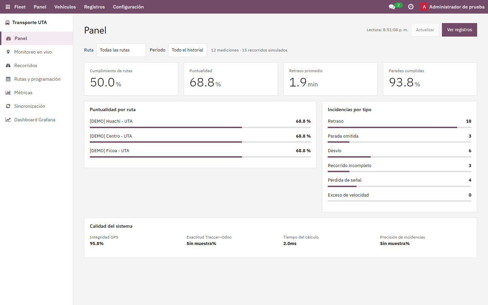 | 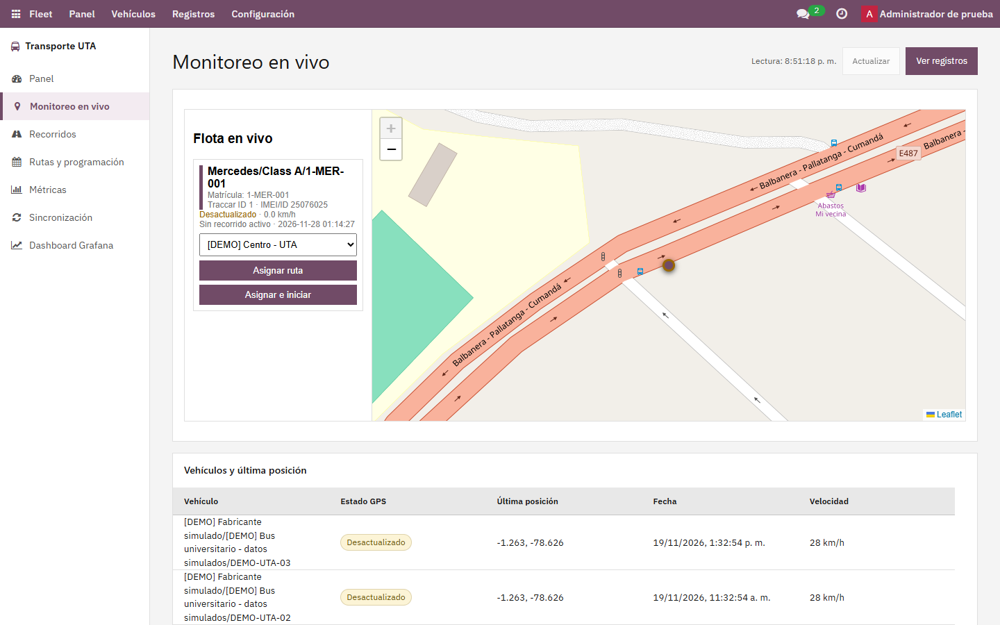 |

| Historial de recorridos | Línea de tiempo |
|---|---|
| 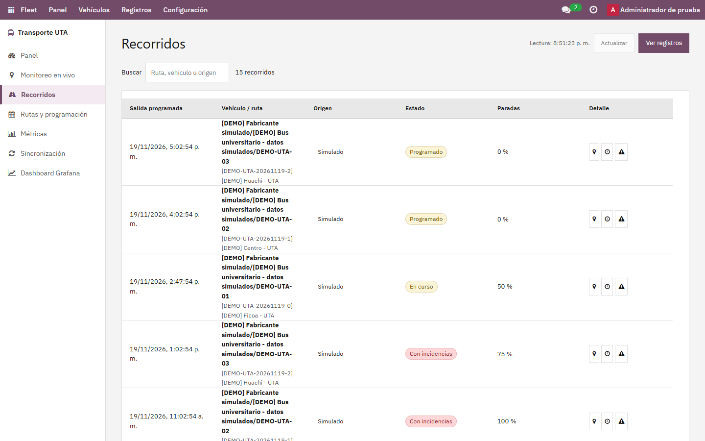 | 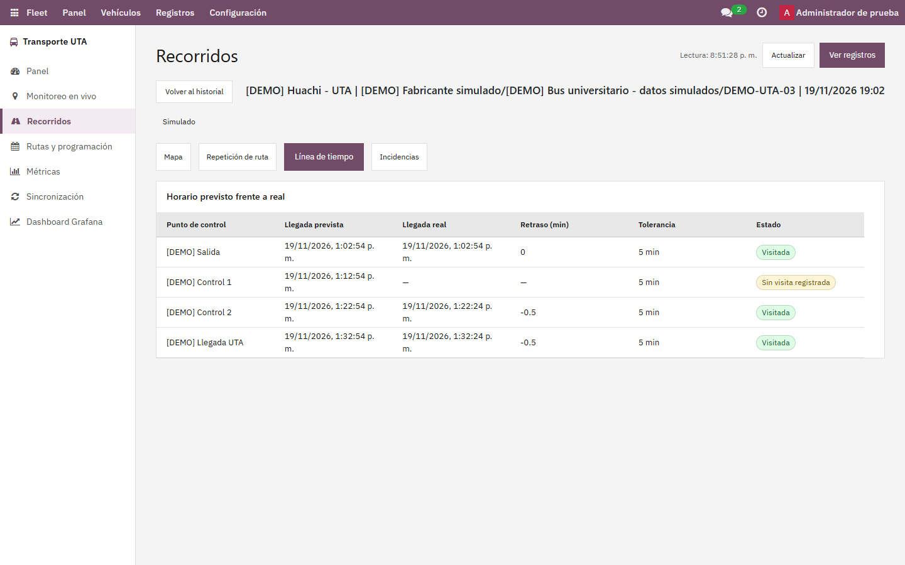 |

| Mapa del recorrido | Incidencias del recorrido |
|---|---|
| 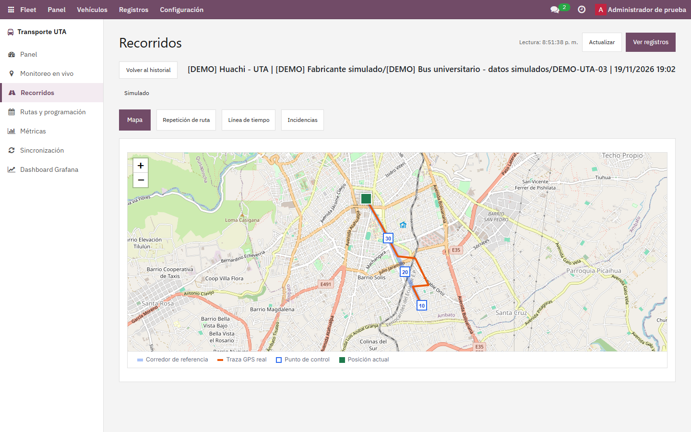 | 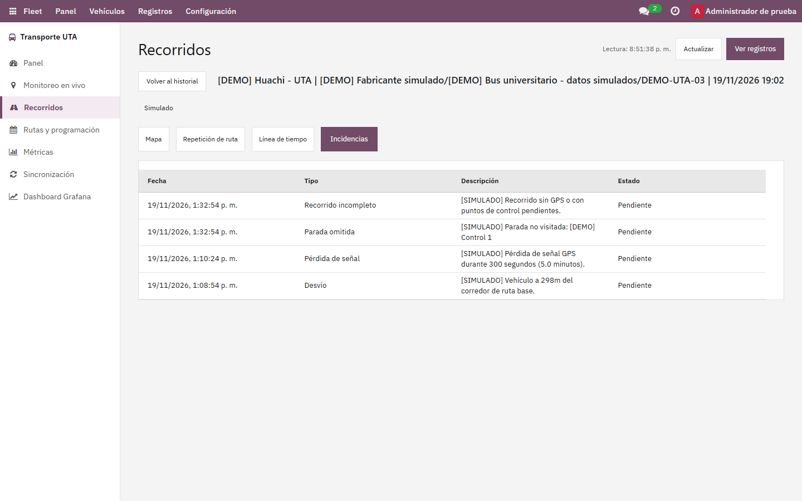 |

| Rutas | Programación |
|---|---|
| 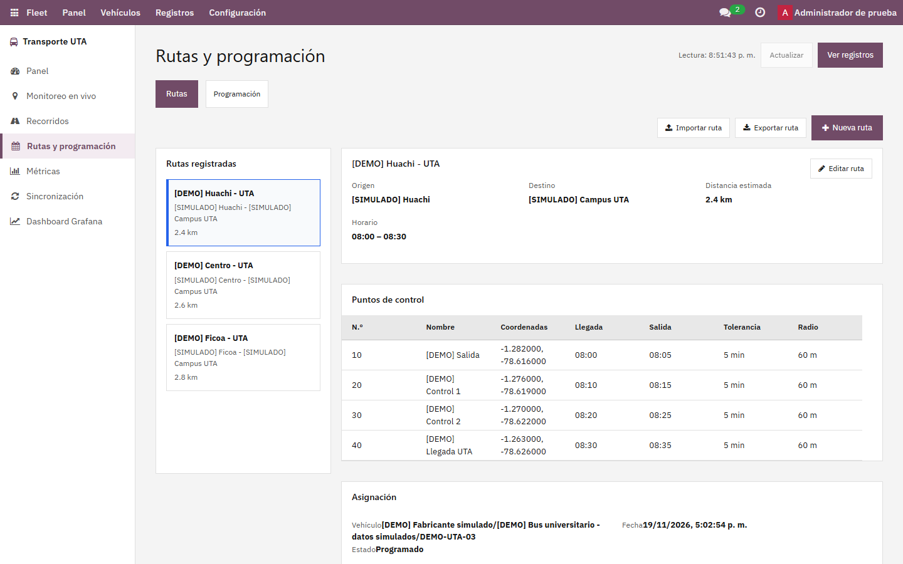 | 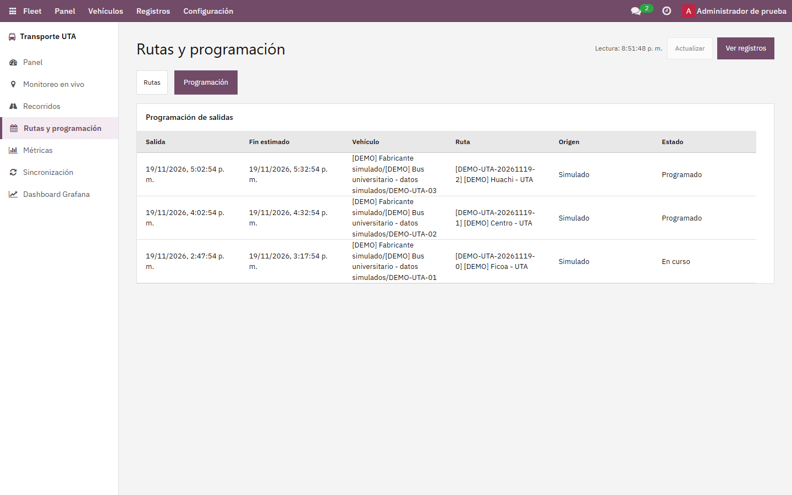 |

| Métricas | Sincronización |
|---|---|
| 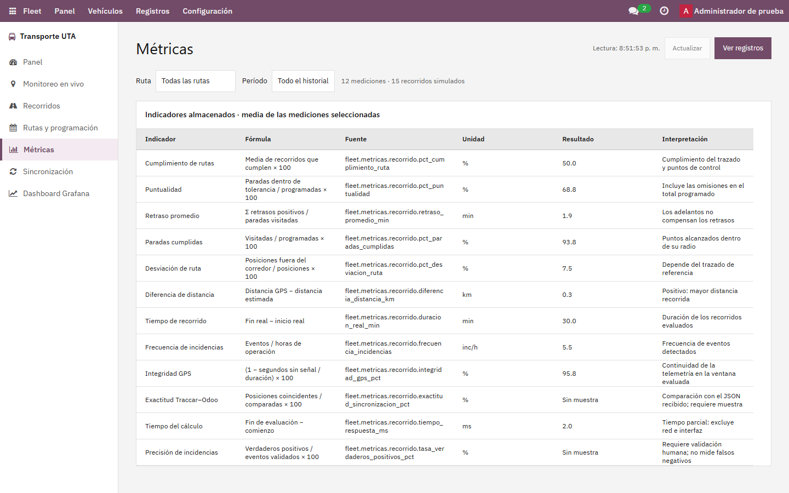 | 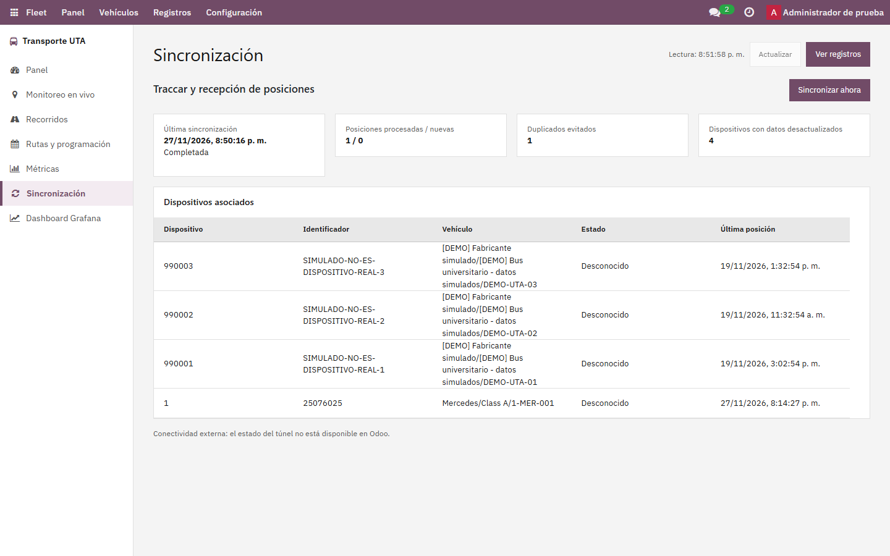 |

### Grafana y vistas nativas
| Grafana | Lista de recorridos |
|---|---|
| 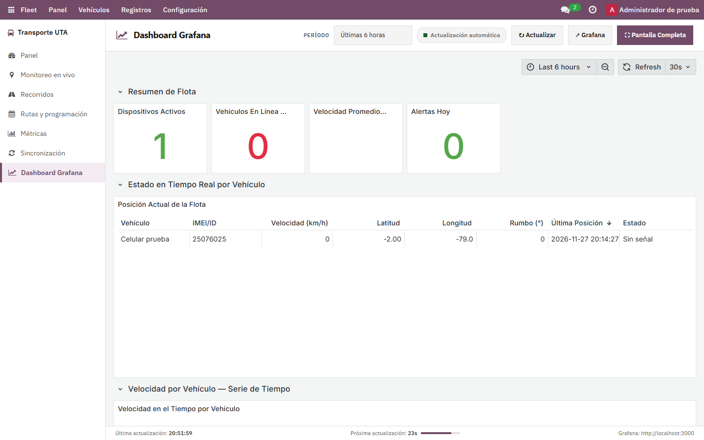 | 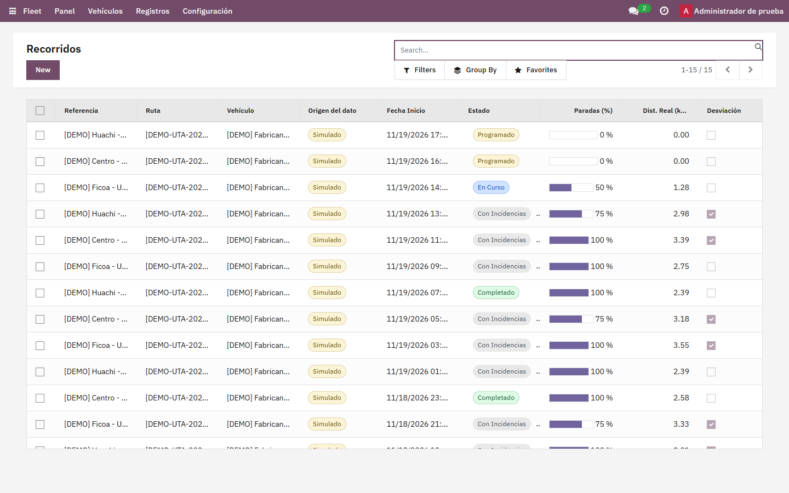 |

| Lista de incidencias | Lista de métricas |
|---|---|
| 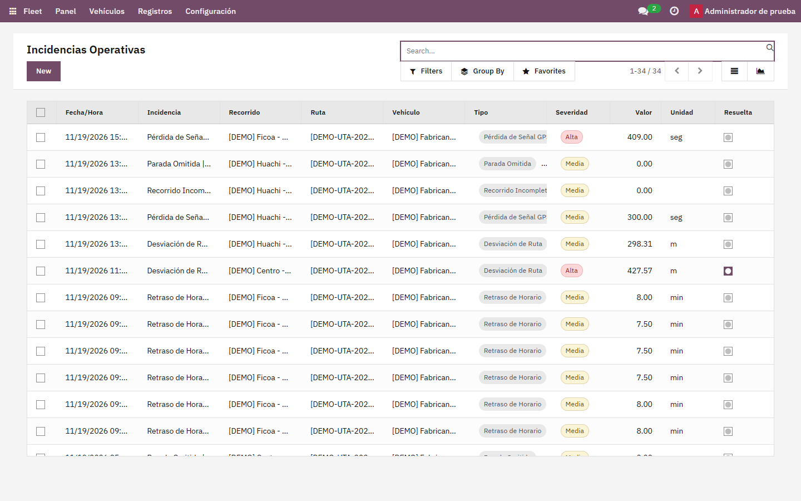 | 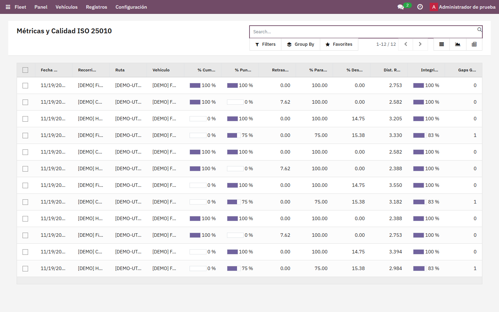 |

### Móvil
| Panel de Odoo | Pasajero: en vivo | Pasajero: recorridos | Pasajero: avisos |
|---|---|---|---|
| 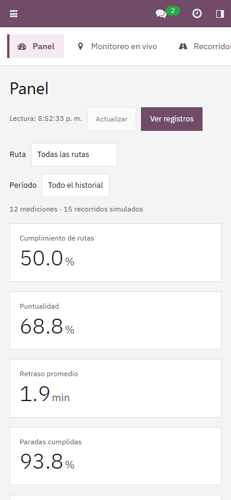 | 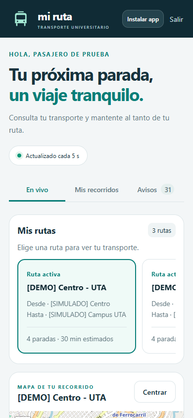 | 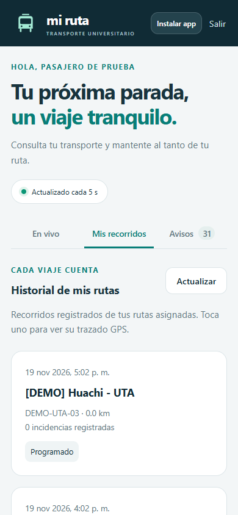 | 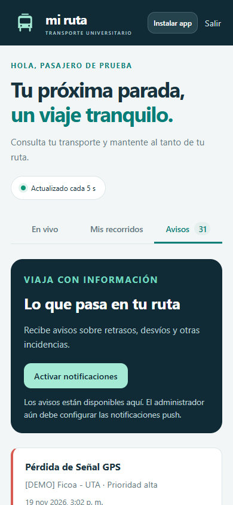 |

## 3. Observaciones de la inspección
Revisión visual de una sola persona según las heurísticas de Nielsen; no sustituye la prueba con usuarios. Severidad: 1 cosmético, 2 menor, 3 importante, 4 grave.

| ID | Observación | Heurística | Sev. | Captura |
|---|---|---|--:|---|
| U01 | Los indicadores y consultas del PDF están repartidos: ubicación, rutas, historial, cumplimiento y distancias requieren cinco pestañas | Reconocer antes que recordar | 3 | 01, 02, 03, 06, 08 |
| U02 | El Panel muestra 4 de las 8 métricas de transporte como tarjetas; desviación, distancia, tiempo y frecuencia están en Métricas | Diseño y organización | 3 | 01, 08 |
| U03 | No hay comparación entre períodos; entre rutas solo se grafica la puntualidad | Adecuación a la tarea | 3 | 01 |
| U04 | El detalle muestra horas distintas del mismo recorrido: 19:02 en el título y 13:02 en la tabla. Los usuarios reales de la base tienen zona `Europe/Brussels` o ninguna, causa probable | Consistencia | 4 | 04 |
| U05 | El panel lateral del mapa en vivo muestra la hora en UTC y la tabla inferior en hora local | Consistencia | 3 | 02 |
| U06 | El panel lateral lista 1 vehículo y la tabla incluye además los simulados | Consistencia | 2 | 02 |
| U07 | La columna "Salida" de las paradas muestra la llegada más la tolerancia (`fleet_dashboard.js:1016`) | Correspondencia con el mundo real | 3 | 06 |
| U08 | Se muestra "Sin muestra%", con la unidad pegada a un valor inexistente | Claridad | 2 | 01 |
| U09 | La tabla de métricas expone nombres técnicos (`fleet.metricas.recorrido.pct_…`) | Lenguaje del usuario | 2 | 08 |
| U10 | Mezcla de idiomas ("New", "Search…", "Filters", "Fleet") y fechas en dos formatos; solo está instalado `en_US` | Consistencia | 3 | 01, 11, 12 |
| U11 | Nombres de vehículo muy largos y columnas truncadas dificultan leer las tablas | Diseño minimalista | 2 | 03, 07, 11, 13 |
| U12 | La vista Programación no tiene un botón para crear; hay que usar "Ver registros" | Visibilidad de acciones | 3 | 07 |
| U13 | Las etiquetas de "Asignación" aparecen pegadas a sus valores | Legibilidad | 2 | 06 |
| U14 | Las barras de incidencias usan una escala fija (cantidad × 5), no proporcional al total (`fleet_dashboard.js:777`) | Correspondencia | 2 | 01 |
| U15 | Grafana añade otro panel con su propio selector de período, duplicado, y coordenadas redondeadas | Consistencia y precisión | 3 | 10 |
| U16 | Los datos simulados dominan las pantallas; el aviso en el Panel es un texto pequeño | Estado del sistema | 3 | 01, 03 |
| U17 | En móvil las pestañas quedan fuera de la vista y las tarjetas obligan a desplazarse | Flexibilidad | 2 | 14 |
| U18 | Pasajero: el encabezado ocupa gran parte de la pantalla y no hay tiempo de llegada ni próxima parada | Adecuación a la tarea | 3 | 15 |
| U19 | Pasajero: 31 avisos acumulados, con incidencias de días anteriores | Relevancia de la información | 2 | 17 |
| U20 | No existe acceso a Traccar dentro de Odoo (O5) | Adecuación a la tarea | 3 | 01 |

U04, U07 y U14 parecen defectos de funcionamiento, no solo de diseño.

## 4. Tareas de usabilidad

### Protocolo
- **Participantes:** al menos 5 personas que no hayan desarrollado el sistema; usar códigos (P1…P5), sin nombres.
- **Punto de partida:** sesión iniciada como administrador, en Flota → Panel. Volver ahí antes de cada tarea.
- **Equipo:** el mismo computador, resolución, datos y orden de tareas antes y después. Usar una copia de la base, porque T4 crea un registro.
- **Moderador:** lee la tarea, no ayuda ni señala. Si la persona pide ayuda o supera 3 minutos, se registra como no lograda.
- **Se mide:** éxito (1 sin ayuda, 0,5 con errores que corrige o respuesta parcial, 0 no lograda), tiempo en segundos, clics, errores y facilidad percibida al terminar (1 muy difícil a 7 muy fácil).

### Tareas

| ID | Enunciado que se lee | Respuesta correcta | Ruta mínima actual |
|---|---|---|---|
| T1 | "¿Dónde está el vehículo 1-MER-001 y a qué hora local envió su última posición?" | Ubicación en el mapa y fecha de la tabla inferior | Monitoreo en vivo: 1 clic, más desplazamiento |
| T2 | "En el recorrido de Huachi del 19/11 a las 13:02, ¿qué parada no visitó y qué incidencias tuvo?" | Control 1; incompleto, parada omitida, pérdida de señal y desvío | Recorridos → icono de horarios → Incidencias: 3 clics, más búsqueda de la fila |
| T3 | "En los últimos 30 días, ¿qué puntualidad y retraso promedio tienen las rutas Centro y Huachi? ¿Cuál es peor?" | Valores que muestre el sistema al preparar la sesión; anotarlos antes | Panel: selector de período y cambiar la ruta dos veces |
| T4 | "Programe un recorrido de la ruta Centro para mañana a las 07:00 con el vehículo 1-MER-001." | Registro guardado con ruta, vehículo, fecha y hora correctos | Rutas y programación → Programación → Ver registros → New → completar → guardar |
| T5 | "¿Está funcionando la sincronización con Traccar? Diga cuándo fue la última y cuántos dispositivos están desactualizados." | Fecha, estado y número de la pantalla | Sincronización: 1 clic |

Antes de cada sesión, comprobar que T2 y T3 sigan correspondiendo a los datos. La ventana de 30 días se calcula desde el día de la prueba.

### Metas propuestas (aprobar por el equipo)

| Indicador | Meta del "después" |
|---|---|
| Éxito promedio | ≥ 90 % |
| Facilidad percibida | ≥ 5,5 de 7 |
| Tiempo mediano por tarea | 30 % menor que el "antes" |
| Pantallas para consultar todo lo que exige la actividad 8 | 1 (ahora 5) |

### Registro por participante (copiar una tabla por persona)
Participante: ____ · Fecha: ____ · Versión: ____ · Experiencia previa con Odoo: sí / no

| Tarea | Éxito (0 / 0,5 / 1) | Tiempo (s) | Clics | Errores | Facilidad (1–7) | Comentarios |
|---|---|---|---|---|---|---|
| T1 | | | | | | |
| T2 | | | | | | |
| T3 | | | | | | |
| T4 | | | | | | |
| T5 | | | | | | |

### Resumen antes y después

| Tarea | Éxito antes | Éxito después | Tiempo mediano antes | Tiempo mediano después | Facilidad antes | Facilidad después |
|---|---|---|---|---|---|---|
| T1 | | | | | | |
| T2 | | | | | | |
| T3 | | | | | | |
| T4 | | | | | | |
| T5 | | | | | | |

**Estado:** capturas e inspección realizadas; las pruebas con participantes **están pendientes**.
